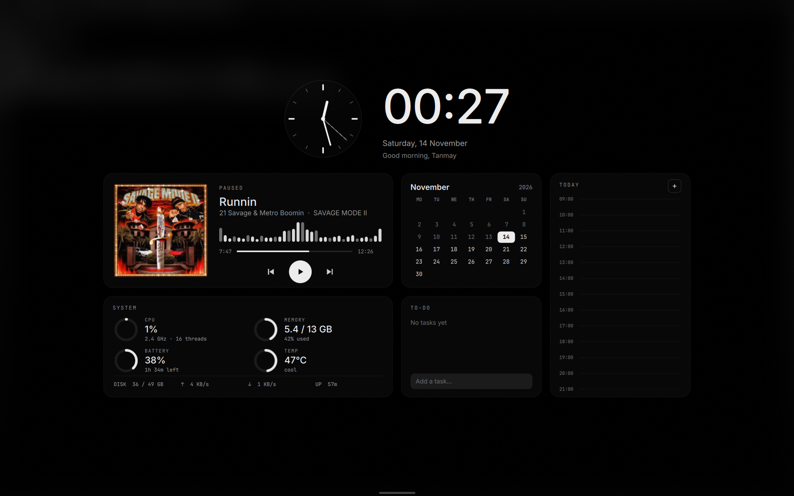

# mono — a minimal Hyprland + Quickshell desktop

A monochrome (black / grey / white), minimal, futuristic desktop for Ubuntu 26.04,
built on **Hyprland** with a fully custom **Quickshell** (QML) shell.



## Features

**Top bar**: a floating centre pill that auto-hides when apps are open
- App grid button, clock and date, workspaces 1–6
- Music pill with a spinning vinyl and bouncing bars; click it for an Apple-style Now Playing card (seek, shuffle, repeat, volume)
- Wi-Fi, Bluetooth, volume and battery; click for Quick Settings, scroll for volume
- Current app name: click for a dropdown of open windows, double-click to maximise or restore
- Minimise, maximise and close buttons, plus a "N hidden" pill for minimised apps
- Battery icon that changes colour: green with ⚡ when charging, yellow in Power Saver, red below 15%
- Click the battery for a menu with charge level, time remaining and Performance / Balanced / Power Saver
- Switches to Power Saver automatically below 30% and restores your mode when you plug in

**Dashboard** (`Super + W`)
- Analog and digital clock with a greeting
- Music card with a live cava visualiser
- Calendar, CPU, RAM, disk, temperature and battery rings
- Day planner with time slots (09:00–21:00) and a to-do list, saved locally
- Transparent on an empty desktop, frosted glass over apps

**Windows-like behaviour**
- Apps open maximised, with minimise and restore
- Alt+Tab switcher and Task View with live previews (`Super + Tab`)
- Resize from the window edges

**Everything else**
- Auto-hiding dock (hover the bottom line, or `Super + Space`)
- Full-screen app grid with search (`Super + A`)
- Quick Settings: Wi-Fi list with password entry, Bluetooth devices, volume and brightness sliders, power menu
- Volume and brightness OSD, notifications
- Wallpaper that blurs when windows are open
- hyprlock lock screen and hypridle (dim, lock, screen off, suspend)
- Touchpad gestures: 3-finger up for the app grid, 3-finger down for the dashboard, 3-finger sideways to switch workspaces, 4-finger up/down for volume
- Black and green GRUB theme

## Keybinds

| Keys | Action |
|---|---|
| `Super + Enter` | Terminal (kitty) |
| `Super + E` | Files |
| `Super + A` / `Super + D` | App grid / fuzzel |
| `Super + W` | Dashboard |
| `Super + Space` | Dock |
| `Super + Tab` | Task View |
| `Alt + Tab` | Window switcher |
| `Super + Q` | Close window |
| `Super + H` / `Super + Shift + H` | Minimise / show minimised |
| `Super + Shift + F` | Maximise / restore |
| `Super + F` / `Super + V` | Fullscreen / float |
| `Super + C` | Clipboard history |
| `Super + Shift + S` / `Print` | Screenshot area / full |
| `Super + L` | Lock |
| `Super + I` | Settings |
| `Super + Shift + R` | Restart shell |
| `Super + 1–6` | Workspaces |

## Structure

```
hypr/          hyprland.conf, hyprlock.conf, hypridle.conf
quickshell/    shell.qml + components (Bar, Dashboard, Dock, AppGrid, QuickSettings, ...)
quickshell/scripts/   status, stats, bluetooth, screenshot, maximise helpers
grub/mono/     GRUB theme
applications/  Apple Music web-app launcher
wallpapers/    wallpaper
```

## Install (Ubuntu 26.04)

```bash
sudo add-apt-repository -y ppa:avengemedia/danklinux
sudo apt install -y hyprland quickshell hyprlock hypridle hyprpolkitagent \
  kitty fuzzel nautilus playerctl brightnessctl cava grim slurp wl-clipboard \
  cliphist blueman imagemagick libnotify-bin power-profiles-daemon fonts-inter fonts-jetbrains-mono
sudo usermod -aG video $USER   # brightness control

cp -r hypr/* ~/.config/hypr/
cp -r quickshell ~/.config/
```

Then:
- Put `wallpapers/flower.jpg` where you want it and update the path in `quickshell/Wallpaper.qml` and `hypr/hyprlock.conf`
- Make the blurred copy: `mkdir -p ~/.cache/wallpaper && magick flower.jpg -resize 50% -blur 0x25 ~/.cache/wallpaper/flower-blur.jpg`
- Log in to the **Hyprland** session
- Optional GRUB theme: copy `grub/mono` to `/boot/grub/themes/`, set `GRUB_THEME=/boot/grub/themes/mono/theme.txt` in `/etc/default/grub`, then run `sudo update-grub`

Tested on a Lenovo Yoga with Intel Iris Xe at 1.25 scaling.

## Credits

- [Hyprland](https://hyprland.org) and [Quickshell](https://quickshell.org)
- Inspired by [Caelestia](https://github.com/caelestia-dots)
- Wallpaper: photo by Christian Boragine on [Unsplash](https://unsplash.com)
